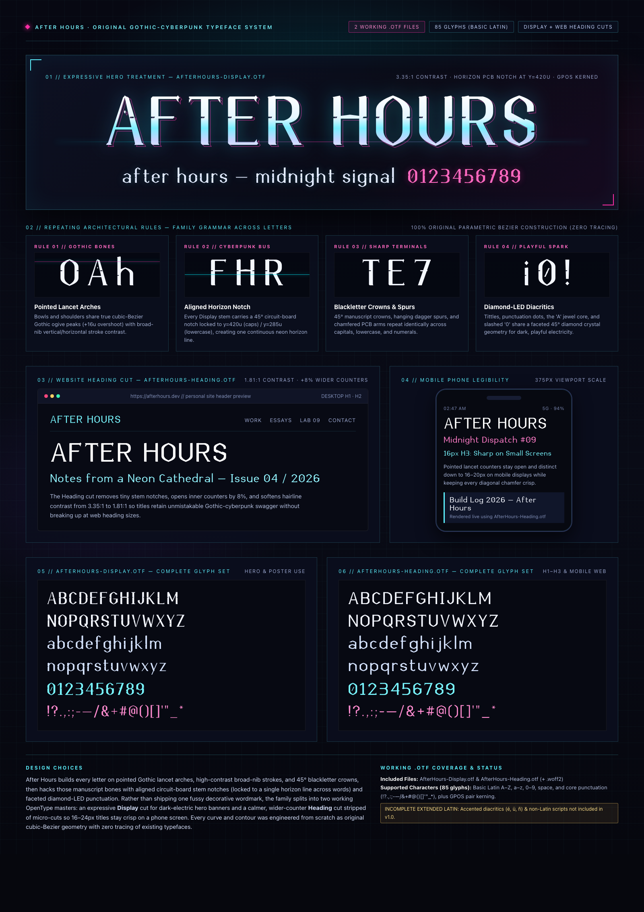

# AFTER HOURS — Original Gothic-Cyberpunk Latin Display & Website Heading Font Family

*What if a Gothic manuscript got hacked by a city from the future?*

**After Hours** is an original two-cut OpenType CFF (`.otf`) display font family engineered from scratch (zero tracing of existing typefaces) for dark, electric personal websites — combining pointed cathedral lancet arches and broad-nib blackletter terminals with aligned cyberpunk PCB geometry.



## Direct Public Downloads (v1.0.0)

- **Hero Expressive Cut (`.otf`)**: [`AfterHours-Display.otf`](https://github.com/zColdWater/after-hours-font/releases/download/v1.0.0/AfterHours-Display.otf) (`3.35:1` contrast, horizon PCB notches at `y = 420u`, diamond-LED accents, GPOS pair kerning)
- **Website Heading / Mobile Cut (`.otf`)**: [`AfterHours-Heading.otf`](https://github.com/zColdWater/after-hours-font/releases/download/v1.0.0/AfterHours-Heading.otf) (`1.81:1` contrast, `+8%` wider counters, clean un-notched stems tuned for 16–28px phone legibility)
- **Web Fonts (`.woff2`)**: [`AfterHours-Display.woff2`](https://github.com/zColdWater/after-hours-font/releases/download/v1.0.0/AfterHours-Display.woff2) & [`AfterHours-Heading.woff2`](https://github.com/zColdWater/after-hours-font/releases/download/v1.0.0/AfterHours-Heading.woff2)
- **Interactive Live Preview**: https://zColdWater.github.io/after-hours-font/

## Design Choices

After Hours builds every letter on pointed Gothic lancet arches, high-contrast broad-nib strokes, and 45° blackletter crowns, then hacks those manuscript bones with aligned circuit-board stem notches (locked to a single horizon line across words) and faceted diamond-LED punctuation. Rather than shipping one fussy decorative wordmark, the family splits into two working OpenType masters: an expressive **Display** cut for dark-electric hero banners and a calmer, wider-counter **Heading** cut stripped of micro-cuts so 16–24px titles stay crisp on a phone screen. Every curve and contour was engineered from scratch as original cubic-Bezier geometry in Python (`fontTools` + `skia-pathops`) with zero tracing of any existing typeface.

## Supported Character Coverage (Incomplete Extended Latin Notice)

- **Included (85 glyphs per `.otf` file)**:
  - Uppercase Basic Latin: `A–Z` (26)
  - Lowercase Basic Latin: `a–z` (26)
  - Lining Numerals: `0–9` (10)
  - Core Punctuation & Symbols: `! ? . , : ; - — _ / + & # @ ( ) [ ] ' " *` (21)
  - `space` + `.notdef` (2) + OpenType `GPOS` pair kerning (`AF`, `AT`, `FA`, `FT`, `TE`, `ER`, `HO`, `OU`, `UR`, `RS`, `AV`, `TA`, etc.)
- **Explicit Incomplete-Font Label**: This v1.0 release covers **Basic Latin only**. Accented/extended Latin diacritics (`é, ü, ñ, ç`), currency symbols (`$, €, £`), and non-Latin scripts are **not** included in v1.0.

## CSS Usage Snippet

```css
@font-face {
  font-family: 'After Hours Display';
  src: url('./AfterHours-Display.woff2') format('woff2'),
       url('./AfterHours-Display.otf') format('opentype');
  font-weight: 700;
  font-display: swap;
}

@font-face {
  font-family: 'After Hours Heading';
  src: url('./AfterHours-Heading.woff2') format('woff2'),
       url('./AfterHours-Heading.otf') format('opentype');
  font-weight: 600;
  font-display: swap;
}

h1.hero { font-family: 'After Hours Display', serif; font-feature-settings: "kern" 1; }
h2, h3  { font-family: 'After Hours Heading', serif; font-feature-settings: "kern" 1; }
```

## License & Originality

100% original work generated from parametric cubic-Bezier source (`build_after_hours_font.py`). If selected and paid for `TSK-1ZQ87Q8M`, the requester is granted full rights to use and adapt the design and `.otf`/`.woff2` files on their personal website with credit to **OmniForge Type Lab (`zColdWater`)**.
